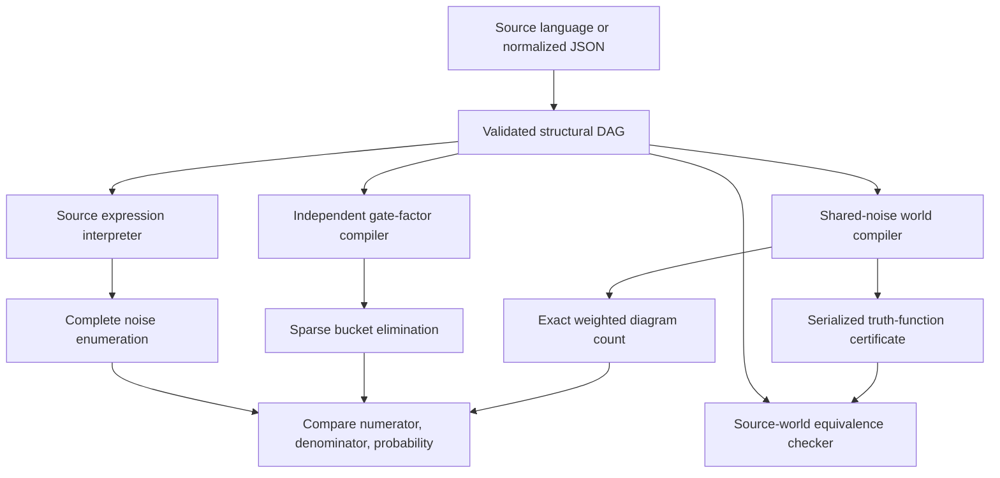

# Algorithms and invariants

## Three paths to the same query



The backends share model validation and exact rational primitives. Their gate
evaluators and reduction strategies are separate. Agreement is useful evidence
but cannot detect a shared error in the model contract or arithmetic layer.
Those layers have direct boundary, algebraic, and metamorphic tests.

## Reduced ordered binary decision diagrams

Terminals zero and one have ranks after every noise variable. A nonterminal is
`(rank, low, high)`. Its children have strictly larger ranks. Construction
returns the child when `low == high`, otherwise interns the tuple in a unique
table. Node identity is logical identity within one manager and one order.

`apply` accepts all sixteen binary truth tables. An explicit work stack expands
the earliest rank present in either operand and memoizes the operand pair.
The stack avoids dependence on Perl's recursion depth for tall diagrams. A
per-operation work bound and manager-wide node bound stop exponential growth.

ITE reduces through Boolean apply. Thresholds use a dynamic program over input
roots; repeated or dependent roots remain Boolean functions in the same manager.
Threshold arguments are never assumed independent.

Restriction removes selected decisions. Existential and universal abstraction
combine selected cofactors with OR and AND. Parallel composition substitutes
the original mapping once; it does not recursively rewrite replacements.
Transfer reconstructs through ITE in another manager, so the target can use a
different variable order. Export visits children before parents and assigns
portable consecutive identifiers. Import rejects unreduced, duplicate,
forward-referencing, or rank-violating records.

The complete three-variable campaign checks all 256 truth functions against
truth tables, cofactors, both quantifiers, substitutions, reordered transfer,
satisfying assignment counts, and serialized round trips.

## Weighted counting and differentiation

For a node with variable prior `p` and child masses `L` and `H`:

```text
mass(node) = (1-p)*L + p*H
```

Skipped variables integrate to one. Children precede parents in the reachable
postorder, making the forward computation linear in reachable diagram size,
apart from arbitrary-precision arithmetic costs.

Reverse-mode differentiation starts with adjoint one at the root. A node
contributes `adjoint*(H-L)` to its variable's derivative and passes weighted
adjoints to its children. Contributions add when graph paths reconverge.
The conditional derivative uses the quotient rule:

```text
d(N/D)/dp = (N'*D - N*D') / D^2
```

Tests compare numerator derivatives to independent endpoint differences and
conditional derivatives to separately enumerated numerator and denominator
differences. Posterior marginals count the joint evidence and noise literal.

## Sparse variable elimination

Each exogenous variable contributes a two-row prior factor. Each Boolean gate
contributes a zero-one constraint relating its inputs to one output. Cardinality
expressions lower into small ITE gates rather than one enormous dense factor.
Original and changed worlds share the same exogenous factor variables.

Factors canonicalize their scope and bit-string assignments. Joining indexes
one operand by shared assignments, multiplies compatible rows, and aggregates
duplicate projected assignments exactly. Summation removes one variable.
Zero rows are omitted. Negative weights and malformed keys are rejected.

Min-fill ordering estimates a small elimination width. Bucket elimination
joins the current bucket, sums its variable, then places the result in a later
bucket. Scalar factors accumulate separately. The trace records real joined
row counts and scope widths. Complexity depends on induced width and sparsity;
the backend can reach its limits even when a BDD is compact.

## ZDD explanations

A ZDD node represents a family of finite sets. Its high branch adds the node's
element. The reduction rule is `high == 0`, which removes a useless element
decision. Terminal one is the family containing the empty set; terminal zero
is the empty family. These terminal meanings differ from an unconstrained BDD.

Union, intersection, difference, set-union product, superset exclusion, and
antichain minimization operate on canonical families. Enumeration is separately
bounded because a compact family can contain exponentially many sets.

Positive minimal cut sets require a structurally monotone event. Monotonicity
is checked by looking for `low & !high` in every variable's cofactors. A
counterexample is a Boolean possibility even if its prior mass is zero.

For arbitrary functions, signed prime implicants include low-branch primes
with a negative literal, high-branch primes with a positive literal, and
consensus primes of `low & high`. Antichain minimization removes redundant
literal sets. The consensus term is necessary for completeness. The campaign
compares the result with all ternary cubes and checks minimality against source
truth tables. Overlapping implicants are never summed as disjoint events.

## Complete witnesses

MAP maximizes the mass of a complete exogenous assignment satisfying a root.
The dynamic program includes the most likely values of skipped variables.
An assignment whose diagram event holds but whose mass is zero is not a MAP
witness. The returned source trace distinguishes original and replaced equations.

Nearest witnesses minimize a weighted Hamming distance from a supplied complete
assignment. Impossible noise values under zero or one priors are excluded.
These are realizations of latent noise, not a search for actual repair actions.
Repair planning replaces endogenous equations instead.

## Decisions and prior uncertainty

The repair planner visits feasible action subsets, preserving initial query
interventions and rejecting conflicting pins. Nonnegative costs allow budget
pruning. Sorting by cost and exact risk yields the nondominated frontier. Equal
cost and risk have one lexicographically first representative. A target selects
minimum cost meeting the target; otherwise minimum risk within budget is chosen.

Risk is a multilinear function of independent noise priors. For conditional
risk, fixing every other prior makes the ratio linear-fractional in one prior.
With positive denominator throughout the box, the derivative's sign is constant
along that coordinate. An extremum can therefore be moved to an endpoint, one
coordinate at a time. Skein evaluates all distinct corners and refuses boxes
with impossible evidence at a corner. This argument does not apply to a general
joint-distribution uncertainty set.

Adaptive diagnosis compares the best stopping repair with every affordable
informative sensor. Each reading conditions the factual population. The
objective is expected sensor cost plus repair cost plus failure loss. Memoized
states include readings, remaining budget, and available sensors. Deterministic
readings are discarded; zero-cost informative readings still consume a sensor.

`Policy::verify` independently replays the chosen tree in complete source
worlds, recomputing its cost, risk, and budget compliance. `PolicyOracle` checks
optimality separately with explicit source-world belief subsets and every
stopping repair action. It contains no symbolic compiler or repair-planner calls.

## Paired causal response

For a treatment node `X`, the same noise realization yields outcomes `Y(0)`
and `Y(1)`. Four disjoint response strata partition the factual population:
always absent, helped, harmed, and always present. Their exact probabilities
sum to one. The average effect is `P(Y(1))-P(Y(0))`.

Necessity conditions on factual `X=1,Y=1` and asks whether `Y(0)=0`.
Sufficiency conditions on factual `X=0,Y=0` and asks whether `Y(1)=1`.
An empty population is reported as undefined. Structural monotonicity keeps
zero-weight counterexamples visible. This requires a supplied causal model and
does not identify response strata from an observational dataset.

## Network and temporal compilation

Network edge failures combine independent edge noise with shared endogenous
domain failures. Parallel edges combine before a Floyd-Warshall expansion.
Every reachability stage refers to the preceding immutable stage, producing a
causal DAG even when the physical network has cycles. A separate BFS checker
constructs live physical edges directly and validates every noise realization.
It accepts physical edge and domain interventions, not artificial pins on
internal reachability nodes.

Mission states are unrolled at discrete times. A healthy process can fail; a
failed process can repair. A per-tick common shock overrides that transition.
A persistent shock is one latent variable shared by all times. First-outage
events form a disjoint partition of the ever-outage event. Uptime counts states
before transitions. The Markov solver provides independent checks when the
mission reduces to a finite-state stochastic process.

Markov hitting probabilities use boundary values on targets and closed classes
that cannot reach a target. Expected hitting time is finite only when arrival
has probability one. Stationary equations use exact linear solving and reject
nonunique solutions. Gauss-Jordan solving checks the residual; random
triangular-product constructions test exact determinants and inverses.

## Polynomial and spectral views

The reliability polynomial applies the weighted recurrence symbolically.
Each variable appears with degree at most one because its descendants occur
later in the diagram order. Conditional queries retain separate numerator and
denominator polynomials.

The Walsh transform uses `g=1-2*f` and characters
`chi_S=product(1-2*x_i)`. Exact butterfly operations produce rational
coefficients. Parseval energy equals one. Squared coefficients yield uniform
Boolean influence and symmetric-flip noise stability. These diagnostics use a
uniform input population, even when a model's actual priors differ. The biased
probability reconstruction substitutes `E[1-2*X_i]=1-2*p_i` and is checked against
weighted counting. Spectral enumeration has its own small-variable limit.
